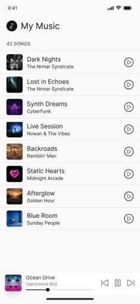
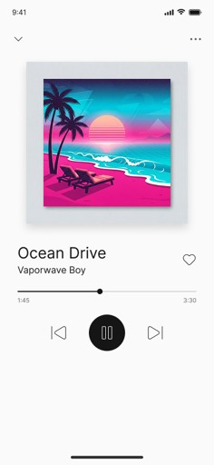
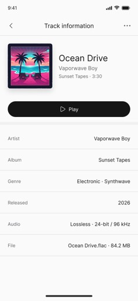
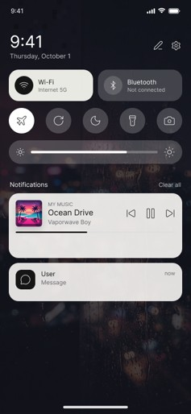
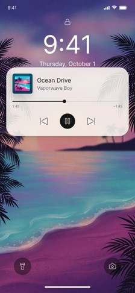

# Music Streaming App

Android client for a music streaming service.  
Browse the catalog, view track details, stream audio and control playback from the notification shade or lock screen.

The app works with a companion backend (`music-backend`) that provides track metadata and audio streaming via HTTP Range Requests.

## Features

- Browse the full music catalog
- View detailed track information (title, artist, cover, metadata)
- Stream audio with Media3 ExoPlayer
- Background playback support
- Media controls in the notification panel
- Media controls on the lock screen
- Offline-first catalog via Room cache
- Automatic synchronization with the server when the network is available

## Tech Stack

| Layer              | Technology                  |
|--------------------|-----------------------------|
| Language           | Kotlin                      |
| UI                 | Jetpack Compose             |
| Architecture       | MVVM + Clean Architecture   |
| Local database     | Room                        |
| Networking         | Retrofit                    |
| Audio playback     | Media3 ExoPlayer            |
| Background playback| MediaSession                |
| Dependency injection | Hilt                      |
| Image loading      | Coil                        |

## Screenshots

<p align="center">
  
  
  
</p>

<p align="center">
  
  
</p>

## Architecture Overview

```
┌────────────────────────┐
│     Android App        │
│  (Compose + Room)      │
└───────────┬────────────┘
            │
            │  REST API
            │  HTTP Range Requests
            ▼
┌────────────────────────┐
│    music-backend       │
│       (Ktor)           │
└───────┬────────┬───────┘
        │        │
        ▼        ▼
  PostgreSQL   Audio Storage
  (metadata)   (mp3 files)
```

- Catalog and track metadata are first loaded from Room.
- When the network is available, the app requests an updated catalog from the server and refreshes the local cache.
- Audio is streamed directly from the backend using HTTP Range Requests.

## Project Structure

```
app/
├── src/main/java/
│   ├── data/           # Repositories, Room, Retrofit
│   ├── domain/         # Use cases, models
│   ├── presentation/   # Compose screens, ViewModels
│   └── di/             # Dependency injection modules
└── src/main/res/
```

## Related Projects

- Backend: [music-backend](https://github.com/nikitasemenchenko/music-backend)
