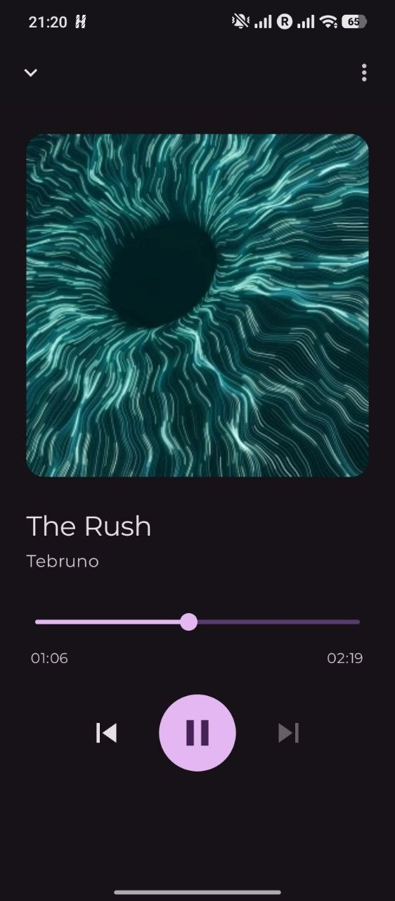
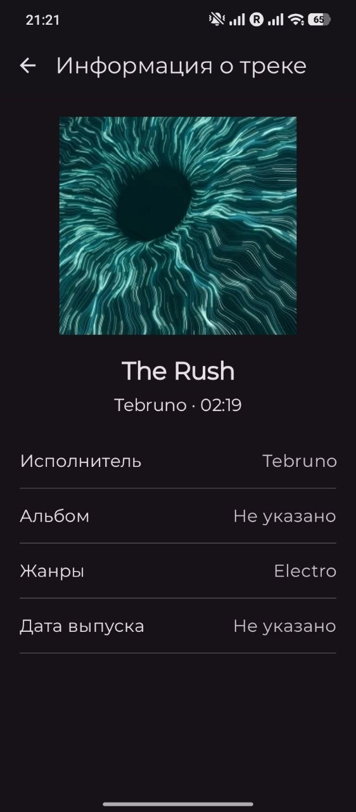
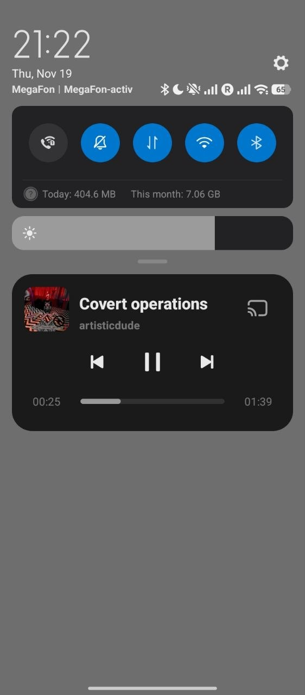
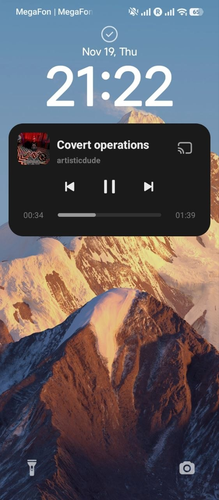

# Spectrum Music Streaming App

Android client for the **Spectrum** music streaming service.  
Browse the catalog, view track details, stream audio in background, and customize app settings.

The app works with a companion backend (`music-backend`) that provides track metadata and audio streaming via HTTP Range Requests.

## Tech Stack

| Layer                  | Technology                              |
|------------------------|-----------------------------------------|
| Language               | Kotlin                                  |
| UI Framework           | Jetpack Compose (Material 3)            |
| Architecture           | MVVM + Clean Architecture               |
| Local Database         | Room 2.7 (with KSP Schema Export)       |
| Key-Value Storage      | Jetpack DataStore Preferences           |
| Networking             | Retrofit + OkHttp                       |
| Audio Playback         | Media3 ExoPlayer                        |
| Background Playback    | MediaSessionService                     |
| Dependency Injection   | Hilt                                    |
| Image Loading          | Coil                                    |

## Architecture Overview

```
┌────────────────────────────────────────────────────────┐
│                   Presentation Layer                   │
│   (CatalogScreen, PlayerScreen, SettingsScreen, UI)    │
└───────────────────────────┬────────────────────────────┘
                            │
┌───────────────────────────▼────────────────────────────┐
│                       Domain Layer                     │
│      (MusicPlayer Interface, Track, PlaybackState)      │
└───────────────────────────┬────────────────────────────┘
                            │
┌───────────────────────────▼────────────────────────────┐
│                        Data Layer                      │
│     (PlayerConnection, Room DB, Retrofit, DataStore)   │
└────────────────────────────────────────────────────────┘
```

- **Clean Architecture**: `presentation` depends strictly on `domain` (e.g. `MusicPlayer` interface).
- Catalog and track metadata are first loaded from Room cache.
- Network sync updates local Room storage in background.
- Audio streaming uses HTTP Range Requests with ExoPlayer.

## Screenshots

<p align="center">
  
  
  
</p>

<p align="center">
  
  
</p>

## Project Structure

```
app/src/main/java/ru/magnum/musicapp/
├── data/           # Repositories, Room DB, Retrofit, ExoPlayer, DataStore
├── domain/         # Models, MusicPlayer interface, Repository contracts
├── presentation/   # Compose screens, ViewModels, UI Utils (UiText, TimeUtils)
└── di/             # Hilt Modules
```

## Related Projects

- Backend: [music-backend](https://github.com/nikitasemenchenko/music-backend)
